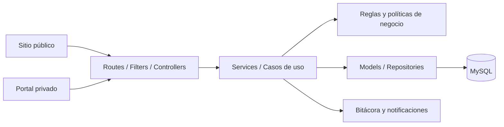

# Arquitectura de software

## Decisión arquitectónica inicial

**Monolito modular con CodeIgniter 4** sobre PHP 8.x, MySQL y vistas server-rendered. Tailwind CSS para estilos compartidos, JavaScript y jQuery donde agreguen valor. Entorno de desarrollo: WAMPServer; producción posterior en hosting compatible.

No introducir microservicios, SPA ni dependencias complejas sin un requerimiento justificado.

## Separación de responsabilidades



- **Routes**: endpoints públicos y privados diferenciados.
- **Filters**: autenticación, autorización y restricciones de recursos.
- **Controllers**: petición/respuesta, sin concentrar las reglas de negocio.
- **Services**: transacciones y procesos que abarcan varias entidades.
- **Models / Entities**: persistencia y representación de datos.
- **Views / componentes**: presentación accesible, responsive y consistente.
- **Migrations**: evolución reproducible de la base.
- **Seeders**: catálogos iniciales no sensibles, idempotentes cuando sea posible.
- **Tests**: flujos felices, errores, permisos y regresiones.

## Módulos de dominio previstos

1. Identity & Access
2. People, Guardians & Athletes
3. Sports Training & Attendance
4. Competitions, Matches & Statistics
5. Billing & Uniform Orders (fondo fundador)
6. Board Treasury & Transparency (fondo Junta)
7. Communication & Case Follow-up
8. Content Management & Public Website
9. Audit, Notifications & Operations

## Convenciones

- Base privada en `/app`; rutas públicas limpias y slugs (por ejemplo `/atletas/{slug}`).
- Autorización **en servidor** y comprobación de pertenencia a atleta/categoría/tesorería; nunca depender solo de botones ocultos.
- Operaciones críticas dentro de transacciones; evitar doble cobro y doble registro.
- Pagos y ajustes inmutables o corregidos por movimientos trazables.
- Separación contable entre cobranza operativa y caja de Junta.
- Archivos originales privados; publicar únicamente derivados aprobados.
- Correo de invitación con enlace único, temporal y de un solo uso. No enviar contraseñas.
- Tareas de correo, recordatorios y respaldo con servicios del hosting cuando se habilite producción.
- Variables y secretos en `.env` ignorado por Git; no subir respaldos de datos reales.
- PR por incremento, revisión antes de integrar a `main`.

## Estructura objetivo de CodeIgniter 4

```text
app/
  Config/
  Controllers/
    PublicSite/
    App/
  Models/
  Entities/
  Services/
  Filters/
  Database/
    Migrations/
    Seeds/
  Views/
    layouts/
    components/
    public/
    app/
public/
tests/
docs/
```

La estructura final debe ajustarse al estado real del proyecto una vez inicializado el framework.

## Entornos

- Local: WAMPServer, base de datos de desarrollo con datos ficticios.
- Pruebas: configuración y base separadas.
- Producción: hosting con PHP/CLI, HTTPS, cron, correo SMTP, almacenamiento y respaldos comprobados.

## Política de despliegue

Cada incremento deberá especificar comandos de migración, dependencias, procedimiento de verificación y estrategia de reversión. No modificar esquema de producción manualmente.
