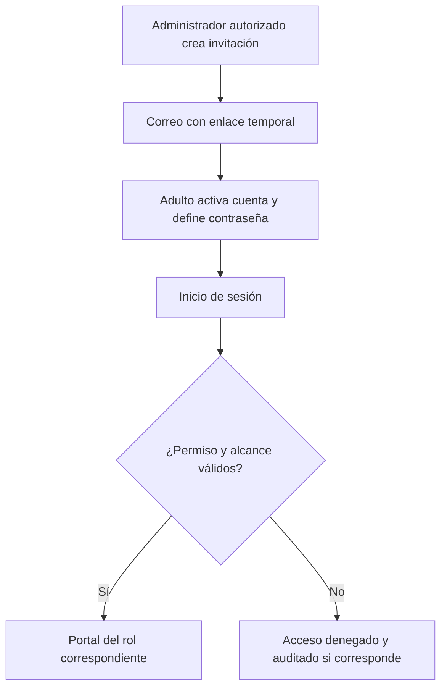

# INC-001 — Fundamentos de la plataforma

**Rama:** `feature/inc-001-fundamentos`  
**Estado:** en implementación. Base CI4, portada, configuración Shield, login institucional, primer dashboard protegido y migraciones propias agregados; ejecución WAMP y pruebas pendientes.

## Objetivo

Establecer las bases del sitio web público y portal administrativo: autenticación, usuarios, roles y permisos, auditoría, layouts y sistema de diseño visual coherente.

## Incluye

1. Inicializar CodeIgniter 4 (PHP 8.x / MySQL) y configuración de entornos.
2. Diseñar migraciones para personas, cuentas, roles, permisos, asignaciones e invitaciones.
3. Crear modelos, servicios y controladores de autenticación y administración.
4. Aplicar filtros de sesión y permiso, con comprobación de recursos.
5. Implementar invitación por correo, activación y recuperación seguras.
6. Registrar auditoría para cambios de accesos.
7. Crear layouts público y privado con tokens institucionales.
8. Preparar pruebas con datos ficticios.
9. Documentar decisiones, comandos de migración y despliegue.

## Fuera de este incremento (sin excluir del proyecto)

Expedientes completos de atletas, cobros, resultados deportivos y fondo de Junta. Se implementarán en incrementos posteriores.

## Flujo de acceso

## Modelo inicial conceptual

`persons`, `users`, `roles`, `permissions`, `user_roles`, `role_permissions`, `invitations` y `audit_logs`. Confirmar nombres y restricciones al implementar migraciones.

## UI mínima

- Página pública y navegación institucional.
- Inicio de sesión / recuperación / activación.
- Layout autenticado responsive.
- Panel inicial con menú según permiso.
- Pantalla restringida de administración de roles y asignaciones.
- Estados de error, éxito, carga y sin datos.

## Pruebas de aceptación

- Usuario invitado activa cuenta una sola vez; enlace expirado rechazado.
- Credenciales inválidas no permiten acceso.
- Cuenta sin permiso no accede a ruta ni recurso protegido.
- Usuario con varios roles recibe unión de permisos aprobados, respetando alcance.
- Cambio de rol queda auditado con actor y fecha.
- Usuario no puede promoverse a superadministrador.
- Portal público visible sin inicio de sesión.
- Layout móvil y escritorio legibles.
- Migraciones se ejecutan en base limpia y pruebas no usan información real.

## Entregables técnicos pendientes

Se incorporaron: base oficial de CodeIgniter 4, controller público, layout, página institucional y CSS responsive; dependencia y configuración Shield, catálogo de permisos, login con identidad visual, dashboard inicial protegido, migraciones `persons`/`audit_logs`, modelos y servicio básico de auditoría. Pendientes en **esta misma rama**: validar Composer/Shield, migraciones y rutas en WAMP, diseñar e implementar el proceso seguro de invitaciones y asignación de permisos, pruebas automatizadas, componentes definitivos Tailwind. Véase [instalación local](instalacion-local.md) y [autenticación y permisos](autenticacion-y-permisos.md).

## Criterio de cierre

El incremento no se considera desarrollado hasta disponer de código operativo, pruebas y revisión en PR. La documentación sola constituye planificación.

## Identidad visual — INC-001A (implementado en código)

Se incorporó una copia optimizada del escudo oficial proporcionado por la academia, ubicada en `public/assets/img/brand/escudo-oficial.svg`. La utilizan los layouts público y privado, login, pie de página y favicon.

El recurso conserva el arte original mediante una imagen WebP embebida en un contenedor SVG. Su tamaño es apropiado para cabeceras e íconos, **no para impresión o portada grande**.

### Criterios de validación en WAMP

- [ ] El logo se ve correctamente en `/`.
- [ ] El logo se ve sobre fondo azul en `/login`.
- [ ] El logo aparece en `/app` tras autenticación.
- [ ] El favicon carga en el navegador.
- [ ] Header y footer mantienen proporciones en móvil y escritorio.
- [ ] No hay errores 404 de imágenes ni problemas de caché.

La especificación de identidad y futuras variantes se encuentra en [sistema de diseño](../../sistema-diseno.md).

## Contenido institucional del sitio (actualización)

La academia proporcionó `Academia de Futbol.docx` con quiénes somos, misión, visión, objetivos y fundamentación. Se actualizaron los textos públicos para reflejar esos contenidos y se añadieron secciones de misión, visión y fundamento, con estilos responsive. Véase [trazabilidad editorial](../../contenido-institucional.md).

- [ ] Verificar en WAMP las nuevas secciones y navegación.
- [ ] Validar la redacción adaptada con los fundadores.
- [ ] Confirmar uso público de la dirección institucional consignada en la fuente.

## Gestión de accesos inicial — corte siguiente

Se incorporaron `RoleAssignmentService`, `RoleAssignmentPolicy`, `AccessManagement`, vista `/app/accesos`, estilos y pruebas unitarias de la política. Los cambios de grupos ordinarios quedan limitados al responsable con `users.assign` y su motivo se registra en `audit_logs`. **Aún no se han ejecutado las pruebas en WAMP**, ni se ha diseñado el procedimiento para conceder roles financieros o institucionales sensibles.

Ver [alcance, diagrama y pruebas](gestion-de-accesos.md).

## Primer acceso administrativo (arranque local)

Como la plataforma todavía no tiene cuentas activas, se documentó un procedimiento seguro de creación inicial mediante `php spark shield:user create`, sin contraseñas ni usuarios de demostración en Git. La designación institucional del responsable de permisos es un paso separado. Ver [primer acceso](primer-acceso.md).

- [ ] Ejecutar migraciones locales de Shield y aplicación.
- [ ] Crear primera cuenta únicamente con autorización institucional.
- [ ] Verificar entrada por `/login` y protección de `/app`.
- [ ] Validar acceso a `/app/accesos` únicamente con el grupo delegado.

## Invitación de cuentas — nuevo avance

Se incorporó un primer flujo de invitación administrativa por correo: `/app/invitaciones` (requiere `users.invite`) y `/activar-cuenta/{token}`. El enlace lleva un token aleatorio de 32 bytes, almacenado únicamente como hash, con 48 horas de vigencia y consumo único. La activación solicita nombre de usuario y contraseña y genera la cuenta Shield con un rol ordinario autorizado. Se agregaron migración, modelo, servicio, política y pruebas unitarias.

**Estado:** código subido, no probado aún en WAMP ni con SMTP. **No desplegar a producción** sin verificar mailer, flujo de activación, CSRF, auditoría y doble uso. Ver [invitaciones](invitaciones.md).

## Invitaciones — cancelación y pruebas de correo local

Se agregó un historial limitado a 25 invitaciones con estado, vencimiento y cancelación protegida mediante POST, CSRF y autorización `users.invite`. La operación queda auditada; el reenvío se hace generando un **token nuevo** después de cancelar la invitación anterior. También se incluyó `docker-compose.mailpit.yml` para capturar correos localmente sin enviarlos a familias reales.

Las pruebas end-to-end de SMTP, apertura del enlace, activación y cancelación **siguen pendientes de ejecutar en WAMP**. Ver [guía de invitaciones y Mailpit](invitaciones.md).
