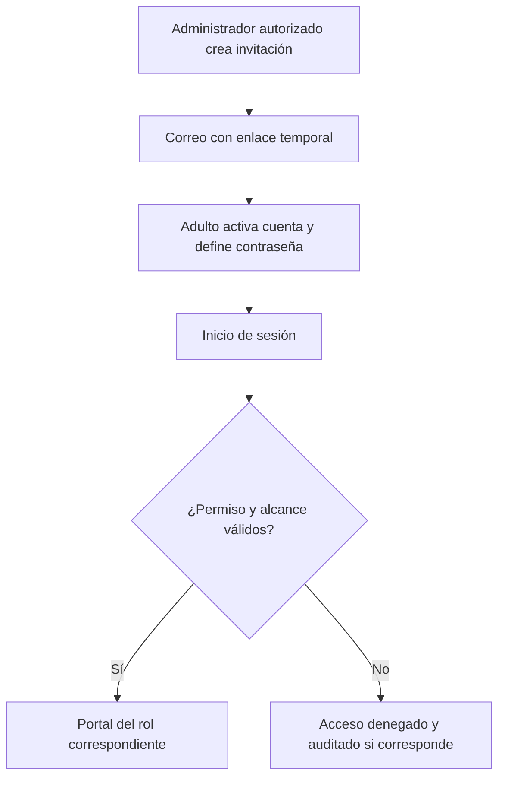

# INC-001 — Fundamentos de la plataforma

**Rama:** `feature/inc-001-fundamentos`  
**Estado:** en implementación. Base CI4 y portada pública agregadas; autenticación, esquema de identidad y pruebas pendientes.

## Objetivo

Establecer las bases del sitio web público y portal administrativo: autenticación, usuarios, roles y permisos, auditoría, layouts y sistema de diseño visual coherente.

## Incluye

1. Inicializar CodeIgniter 4 (PHP 8.x / MySQL) y configuración de entornos.
2. Diseñar migraciones para personas, cuentas, roles, permisos, asignaciones e invitaciones.
3. Crear modelos, servicios y controladores de autenticación y administración.
4. Aplicar filtros de sesión y permiso, con comprobación de recursos.
5. Implementar invitación por correo, activación y recuperación seguras.
6. Registrar auditoría para cambios de accesos.
7. Crear layouts público y privado con tokens institucionales.
8. Preparar pruebas con datos ficticios.
9. Documentar decisiones, comandos de migración y despliegue.

## Fuera de este incremento (sin excluir del proyecto)

Expedientes completos de atletas, cobros, resultados deportivos y fondo de Junta. Se implementarán en incrementos posteriores.

## Flujo de acceso

## Modelo inicial conceptual

`persons`, `users`, `roles`, `permissions`, `user_roles`, `role_permissions`, `invitations` y `audit_logs`. Confirmar nombres y restricciones al implementar migraciones.

## UI mínima

- Página pública y navegación institucional.
- Inicio de sesión / recuperación / activación.
- Layout autenticado responsive.
- Panel inicial con menú según permiso.
- Pantalla restringida de administración de roles y asignaciones.
- Estados de error, éxito, carga y sin datos.

## Pruebas de aceptación

- Usuario invitado activa cuenta una sola vez; enlace expirado rechazado.
- Credenciales inválidas no permiten acceso.
- Cuenta sin permiso no accede a ruta ni recurso protegido.
- Usuario con varios roles recibe unión de permisos aprobados, respetando alcance.
- Cambio de rol queda auditado con actor y fecha.
- Usuario no puede promoverse a superadministrador.
- Portal público visible sin inicio de sesión.
- Layout móvil y escritorio legibles.
- Migraciones se ejecutan en base limpia y pruebas no usan información real.

## Entregables técnicos pendientes

Se incorporaron la base oficial CodeIgniter 4, controller público, layout, página institucional y CSS responsivo. Pendientes en **esta misma rama**: migraciones, seeders de catálogos, models, services, controladores de identidad, filtros, rutas privadas, pruebas y validación de entorno local. Véase [instalación local](instalacion-local.md).

## Criterio de cierre

El incremento no se considera desarrollado hasta disponer de código operativo, pruebas y revisión en PR. La documentación sola constituye planificación.
