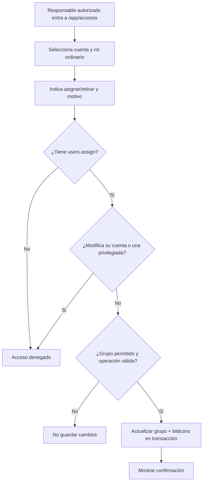

# INC-001 — Gestión inicial de accesos

**Estado:** implementado en código, **sin ejecución verificada en WAMP**. Requiere revisión de las autoridades institucionales.

## Propósito

Cumplir la decisión de que la asignación de permisos se concentre en **una persona designada**, sin conceder automáticamente esa facultad a cualquier usuario que gestione otras funciones de la academia.

## Primera implementación

- Página privada: `/app/accesos`.
- Acceso: sesión Shield y permiso `users.assign`.
- Visualización: cuenta, identificador y grupos actuales (sin mostrar contraseñas ni fichas de atletas).
- Cambios disponibles: **asignar** o **retirar** uno de los grupos `guardian`, `coach`, `media_contributor`.
- Cada cambio exige motivo, registra actor, objetivo y grupo, y se procesa con auditoría en la misma transacción.
- Prohibida la autoasignación y cualquier cambio sobre una cuenta con grupos `institutional_admin`, `access_manager` o `technical_support`.
- No se permiten desde esta pantalla roles financieros ni institucionales sensibles.

## Flujos



## Límites importantes

1. **No se ha implementado todavía el alta ni la invitación por correo** para familias. El responsable puede gestionar ciertos roles de cuentas ya creadas.
2. Los grupos de permiso **no limitan automáticamente** un entrenador a su categoría o un responsable a sus hijos. Esa verificación por recurso se implementará con sus módulos funcionales.
3. El otorgamiento de `institutional_admin`, `access_manager`, `board_treasurer`, `equipment_manager`, `sports_director` y `technical_support` requiere flujo específico de autorización institucional aún pendiente.
4. El listado de usuarios no admite edición de correo, contraseñas ni borrado.
5. El código **no debe exponerse en producción** hasta validar Shield, migraciones, CSRF, funcionamiento por roles y gestión de excepciones.
6. Inicialmente la designación de `access_manager` se realiza únicamente por un operador autorizado mediante CLI de Shield.

## Pruebas de aceptación

- [ ] Un visitante sin sesión no accede a `/app/accesos`.
- [ ] Un usuario con sesión sin `users.assign` recibe denegación.
- [ ] El responsable de accesos puede asignar/retirar únicamente roles ordinarios.
- [ ] El responsable no puede modificar su propio registro.
- [ ] No puede editar cuentas administrativas, de responsables de accesos o de soporte.
- [ ] Una petición POST sin token CSRF se rechaza.
- [ ] Un grupo desconocido o sensible se rechaza sin modificación.
- [ ] Un motivo de longitud incorrecta se rechaza.
- [ ] Si falla la auditoría, la modificación del grupo no se confirma.
- [ ] Las modificaciones válidas se reflejan en Shield y en `audit_logs`.
- [ ] La pantalla funciona en móvil, incluyendo desplazamiento horizontal controlado de tablas.

## Verificación de reglas puras

Después de instalar dependencias, desde la raíz del proyecto:

```powershell
vendor\bin\phpunit --bootstrap vendor/autoload.php tests/unit/RoleAssignmentPolicyTest.php
```

La prueba verifica el alcance permitido para roles ordinarios y la protección de cuentas privilegiadas; **no reemplaza** las pruebas de integración de base de datos, rutas y sesiones.
