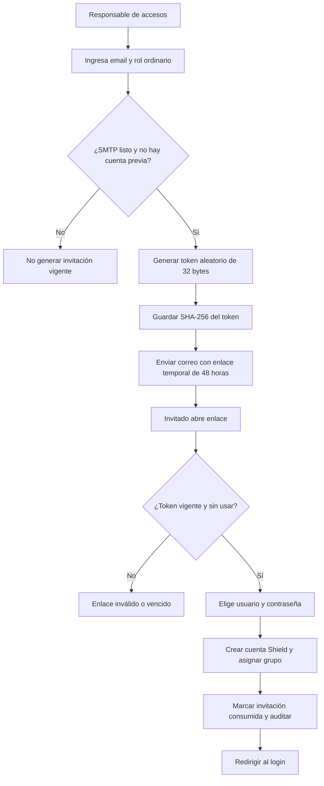

# INC-001 — Invitaciones individuales

**Estado:** implementación inicial en rama, **pendiente de ejecutar y validar en WAMP**.

## Propósito

Solo un responsable designado podrá invitar personas a la plataforma. La academia **no habilita el registro público**. Cada usuario invitado define su propia contraseña mediante un enlace individual.

## Componentes incorporados

- Migración `user_invitations`: email, grupo solicitado, hash del token, estado, responsable, creación, vencimiento y consumo.
- Modelo `UserInvitationModel`.
- Política `InvitationPolicy`.
- Servicio `UserInvitationService`.
- Panel `GET/POST /app/invitaciones` exclusivo de `users.invite`.
- Formulario de activación `GET/POST /activar-cuenta/{token}`.
- CSS institucional responsive, auditoría y pruebas unitarias de reglas puras.

## Flujo funcional



## Restricciones

- Roles invitables: `guardian`, `coach`, `media_contributor`. Roles de tesorería, equipo institucional y soporte requieren autorización distinta.
- Enlace con token criptográficamente aleatorio, almacenado **solo como hash SHA-256**.
- Vigencia inicial: 48 horas. No reutilizable: consumo condicionado por estado y vencimiento en la base.
- No enviar contraseñas ni almacenar el token en texto plano en la base ni la bitácora.
- Se rechaza nueva invitación vigente a un correo ya invitado o con cuenta existente.
- Contraseña: mínimo 12 caracteres, mayúscula, minúscula, número y símbolo; no contiene el nombre de usuario.
- El servidor exige sesión y permiso para crear invitaciones; solo el formulario público de activación acepta el token.
- El formulario público debe llevar CSRF y políticas de caché/referrer restrictivas.
- Las solicitudes de invitación se limitan inicialmente a cinco por responsable y hora.
- No se enlaza automáticamente el padre con un expediente deportivo. Eso se realizará mediante verificación administrativa en INC-003.

## Configuración necesaria para correo

El servidor necesita un SMTP confiable y configuración local de `app.baseURL` pública **accesible para el invitado**. Un enlace a `localhost` enviado a otra computadora no será funcional.

Definir únicamente en `.env` (valores de ejemplo; NO subir secretos):

```ini
email.protocol = smtp
email.SMTPHost = smtp.example.invalid
email.SMTPUser = usuario_smtp
email.SMTPPass = CONTRASENA_SOLO_LOCAL
email.SMTPPort = 587
email.SMTPCrypto = tls
email.fromEmail = invitaciones@example.invalid
email.fromName = 'Academia Ramón Sánchez'
```

**No activar envíos reales hasta validar proveedor, dominio y configuración SMTP.** En desarrollo utilizar un servidor de pruebas de correo o buzón simulado. La funcionalidad informa error cuando SMTP no está configurado.

**Nota operativa:** el correo se envía antes del commit del registro de invitación. Aunque se verifican fallos de envío, el correo externo no participa en la transacción de MySQL; si hubiera un fallo inesperado al confirmar, el enlace podría quedar inválido. Para producción conviene incorporar un patrón outbox/cola con estados de envío y reintentos auditados.

## Pruebas de aceptación pendientes

- [ ] Las rutas `/register` continúan deshabilitadas.
- [ ] Solo `users.invite` puede acceder al panel y enviar invitaciones.
- [ ] Sin SMTP configurado no se confirma un envío.
- [ ] Enviar un correo real únicamente al buzón de prueba autorizado.
- [ ] El enlace vence después de 48 horas.
- [ ] No permite volver a utilizar el mismo enlace.
- [ ] La segunda invitación vigente al mismo correo se rechaza.
- [ ] Solo se crean roles ordinarios autorizados.
- [ ] Se rechaza nombre de usuario duplicado o inválido.
- [ ] El alta Shield y el cambio de estado se confirman en la misma transacción.
- [ ] El proceso no muestra contraseña ni token en logs.
- [ ] Auditoría de invitación y activación persistida.
- [ ] Revisión visual móvil y escritorio.
- [ ] Pruebas unitarias: `vendor\\bin\\phpunit --bootstrap vendor/autoload.php tests/unit/InvitationPolicyTest.php`.

## Pendientes para un uso definitivo

- Reenvío/cancelación de invitaciones por responsable autorizado.
- Cola de envío por SMTP con trazabilidad de entrega y reintentos.
- Plantilla de correo institucional con escudo.
- Relación administrativa previa entre padres y atletas.
- Verificación adicional para cuentas institucionales.
- Pruebas de carga y limitación de intentos.


## Prueba local segura con Mailpit (sin correo real)

La rama incluye `docker-compose.mailpit.yml`, que publica el servidor SMTP de pruebas **solo en 127.0.0.1:1025** y su buzón web en **http://127.0.0.1:8025**. No envía correos a destinatarios externos.

Desde PowerShell, en la raíz del repositorio:

```powershell
docker compose -f docker-compose.mailpit.yml up -d
docker compose -f docker-compose.mailpit.yml ps
```

En tu archivo local `.env` (no subir a Git) añade:

```ini
email.protocol = smtp
email.SMTPHost = 127.0.0.1
email.SMTPPort = 1025
email.SMTPUser =
email.SMTPPass =
email.SMTPCrypto = ''
email.fromEmail = 'pruebas@academia.test'
email.fromName = 'Academia Ramón Sánchez'
```

Mantener `app.baseURL = 'http://localhost:8080/'`. Con el portal y el correo de pruebas en la **misma computadora**, el enlace a localhost puede abrirse correctamente desde Mailpit.

Secuencia sugerida:

1. Ejecutar `php spark migrate --all` y verificar la tabla `user_invitations`.
2. Ingresar con `joseluisroot` a `http://localhost:8080/app/invitaciones`.
3. Usar una dirección sintética `prueba.padre@example.test`, con rol `guardian`.
4. Revisar el mensaje en `http://127.0.0.1:8025`.
5. Abrir el enlace desde el **mismo equipo**. Crear un usuario de prueba distinto a `joseluisroot` y una contraseña robusta.
6. Comprobar que puede iniciar sesión; volver a usar el enlace debe mostrar invitación inválida.
7. Crear otra invitación sintética, **cancelarla** en el listado y comprobar que su enlace deja de funcionar.
8. Reenviar de manera controlada: luego de cancelar, usar nuevamente el formulario para crear otra invitación al mismo correo.
9. Verificar que la auditoría guarda únicamente metadatos permitidos, nunca el token de invitación ni contraseñas.
10. Detener Mailpit cuando no se use: `docker compose -f docker-compose.mailpit.yml down`.

**No utilices correos de familias reales para esta fase.** El servicio no es un SMTP de producción, y las invitaciones enviadas desde localhost no serán accesibles fuera de tu computadora.

## Cancelación y nuevo envío

`POST /app/invitaciones/cancelar` permite a usuarios con permiso `users.invite` cancelar invitaciones en estado `pending`. La cancelación modifica su estado de forma condicionada y registra auditoría en la misma transacción. Una invitación cancelada no puede activar una cuenta.

Para **volver a enviar**, el responsable cancela la anterior si continúa vigente y después genera una invitación nueva desde el formulario: se crea **otro token**, con su propio plazo de 48 horas. No se reutiliza el token original.

El módulo muestra un máximo de 25 invitaciones recientes al responsable autorizado. Esta vista está restringida porque contiene correos personales.

### Advertencia de fiabilidad SMTP

El envío SMTP es un efecto externo y no participa en las transacciones MySQL. La implementación inicial realiza el envío antes de confirmar la invitación y puede tener inconsistencias en un caso excepcional de fallo del commit; antes de producción habrá que sustituirla por una **cola de salida transaccional (outbox)** con reintentos y estados de entrega.
