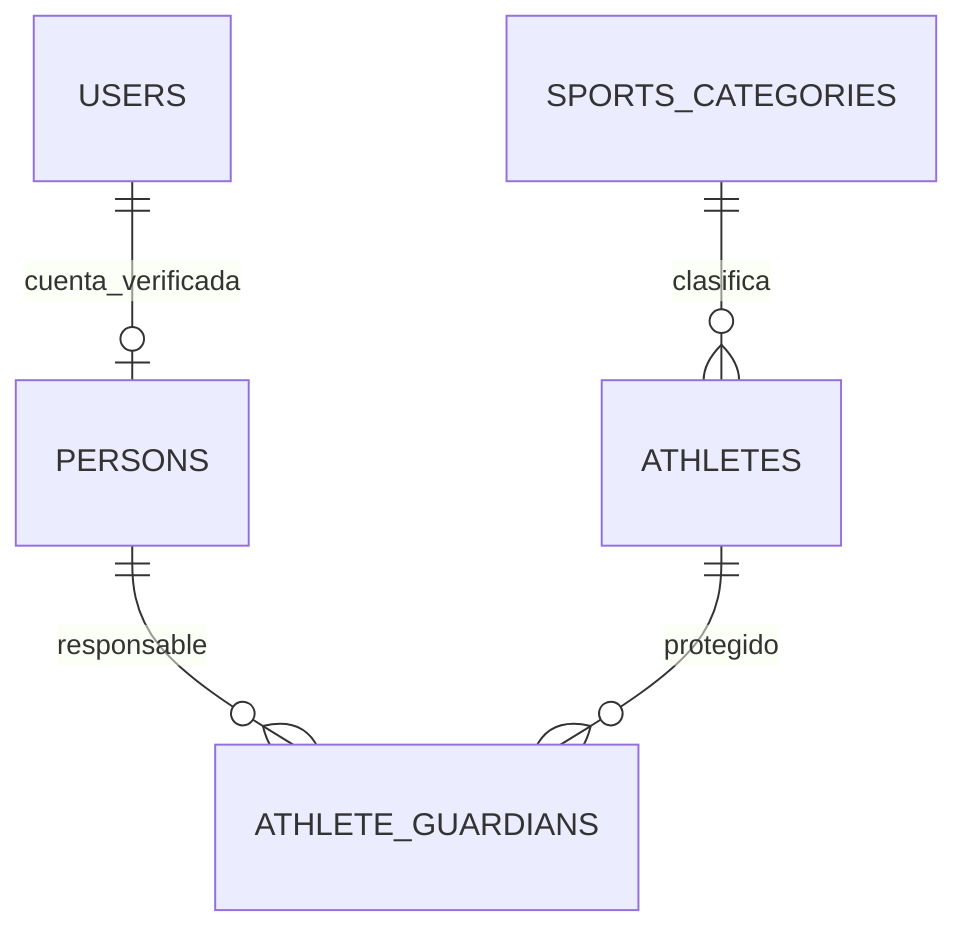

# INC-003 — Personas, familias y atletas

**Rama:** `feature/inc-003-personas-atletas-familias`  
**Base:** `feature/inc-002-sitio-publico-contacto` (PR #2 en borrador).  
**Estado:** primera implementación de código; **no ejecutada ni probada en WAMP**.

## Objetivo

Crear el expediente administrativo privado del atleta y registrar sus adultos responsables con un procedimiento de vinculación de cuentas **verificado** para que ninguna familia pueda consultar la información de otros menores.

## Componentes

- `sports_categories`: catálogo de U7, U9, U11, U13, U17, con seeder idempotente; no se establecen aún rangos automáticos de edades.
- `athletes`: nombres, apellidos, fecha de nacimiento, fecha de ingreso, categoría, estado y usuario administrativo que creó el registro.
- `athlete_guardians`: relación muchos-a-muchos entre atleta y adulto, parentesco, verificador y fecha de verificación.
- `persons`: tabla de adultos ya creada en INC-001; se reutiliza un mismo adulto para varios atletas en lugar de duplicarlo.
- Modelos `AthleteModel`, `SportsCategoryModel`, `AthleteGuardianModel` y `PersonModel`.
- `AthleteRegistrationService`: validaciones, operación transaccional y auditoría; no concede acceso a la familia por registrar un nombre.
- `FamilyLinkService`: verifica manualmente una relación entre adulto registrado y cuenta familiar activa; transacción y auditoría.
- `GET /app/atletas`, `GET /app/atletas/nuevo`, `POST /app/atletas`: gestión exclusiva de `athletes.manage`.
- `GET/POST /app/familias/verificar`: únicamente `family.links.verify` (administradores institucionales).
- `GET /app/mis-atletas`: consulta limitada por `persons.user_id = auth()->id()`, vínculo `verified_at` y atleta activo, exclusiva de rol familiar.
- Interfaces responsive de listado, inscripción, verificación de vínculos y panel familiar.
- Pruebas unitarias de `AthleteRegistrationPolicy`.

## Esquema resumido



Un adulto puede estar asociado a varios atletas; un atleta puede tener varios adultos responsables. La cuenta Shield de un adulto es opcional, y **no otorga acceso hasta que la relación haya sido verificada**.

## Reglas de seguridad

1. El listado administrativo de atletas exige `athletes.manage`. Un `coach` con `athletes.view` general no puede usar esta ruta: se diseñará su alcance por categoría más adelante.
2. El usuario `guardian` nunca especifica un ID arbitrario de atleta al consultar: el servidor obtiene las filas filtrando por su identidad autenticada y relaciones verificadas.
3. La creación de un atleta **no** asigna `persons.user_id` ni marca una relación como verificada.
4. Para asociar cuenta, un administrador con `family.links.verify` debe comprobar previamente identidad y relación de responsabilidad, fuera del formulario, e indicar el correo de la cuenta Shield activa con rol `guardian`.
5. No se permite cambiar un adulto ya vinculado a otra cuenta a través de este proceso. La operación requiere transacción y auditoría.
6. Nunca usar datos reales de menores para pruebas sin autorización. No publicar datos personales, fotos ni estadísticas individuales.
7. La categoría de ingreso se elige administrativamente. **No existe aún norma aprobada de cortes por año/edad** para asignación automática.
8. La captura de información sobre salud, identidad legal, permisos de imagen o disciplina queda fuera de esta fase.

## Instalar y probar

```powershell
cd C:\wamp64\www\acedemia-ramon-sanchez
git fetch origin
git switch --track origin/feature/inc-003-personas-atletas-familias
php spark migrate --all
php spark db:seed SportsCategoriesSeeder
php spark migrate:status
php spark routes
vendor\bin\phpunit --bootstrap vendor/autoload.php tests/unit/AthleteRegistrationPolicyTest.php
```

Si la rama ya existe localmente, usar `git switch feature/inc-003-personas-atletas-familias` y `git pull --ff-only origin feature/inc-003-personas-atletas-familias`.

**Prueba funcional con datos ficticios:** crear atleta con adulto responsable desde `/app/atletas/nuevo`; verificar que padre no lo ve inicialmente; crear la cuenta familiar mediante invitación (si no existe); confirmar vínculo en `/app/familias/verificar`; iniciar sesión familiar y ver solo su atleta en `/app/mis-atletas`.

## Pendiente antes de completar el incremento

- [ ] Ejecutar migraciones, seeder, rutas y pruebas unitarias en WAMP sin errores.
- [ ] Verificar registro transaccional y rollback ante fallos.
- [ ] Verificar que un padre no pueda consultar otros atletas ni relaciones no verificadas.
- [ ] Verificar que el utilero y los entrenadores no puedan autorizar vínculos familiares.
- [ ] Verificar que un adulto reutilizado pueda relacionarse con varios hijos sin duplicar persona.
- [ ] Validar política formal de edades/cambios de categoría con director deportivo.
- [ ] Incorporar edición/historial de cambios, más de un responsable, consentimientos versionados, dorsales y estados de atleta.
- [ ] Implementar revocación y revisión periódica de vínculos familiares.
- [ ] Revisar conservación de datos, seguridad y procedimiento ante conflictos de representación legal.
- [ ] Verificar layout en móvil y registros accesibles solo con permisos explícitos.

## Alcance futuro

INC-004: sesiones y asistencia. INC-005/006: torneos y resultados. INC-008/009: mensualidades y uniformes. Ninguno de esos módulos se mezcla con las autorizaciones familiares iniciales.


## Retroalimentación de interfaz recibida el 21 de noviembre de 2026

Se registró el primer atleta en WAMP (validación comunicada por el usuario). Las mejoras UX de SweetAlert2, DataTables, toast, notificaciones personales y AJAX se trasladaron a [parking lot transversal](../../parking-lot-ux-plataforma.md) para ejecutarse después del flujo completo. El registro del atleta **no equivale a verificación del vínculo familiar ni a prueba de permisos**.

**Próximo recorrido prioritario:** revisar la relación pendiente desde `/app/familias/verificar`, asociar un adulto registrado con su cuenta Shield `guardian` tras comprobación institucional, y confirmar mediante pruebas con dos usuarios familiares separados que `/app/mis-atletas` nunca permite consultar los hijos de otra familia. Usar datos ficticios.


## Segundo corte — edición básica e historial de categoría

Se agregó una migración `2026-11-21-000006_CreateAthleteCategoryHistory.php` que crea `athlete_category_history` y migra automáticamente la categoría inicial de los atletas ya registrados (incluido el primer registro de pruebas) usando su fecha de ingreso.

Las altas posteriores incluyen la categoría inicial en una transacción junto al expediente. La pantalla `/app/atletas/{id}/editar` permite únicamente modificar nombres y categoría con permiso `athletes.manage`; si cambia la categoría, se agrega una entrada con fecha actual y auditoría. No se permite editar fechas de nacimiento/ingreso ni modificar vínculos familiares desde este formulario; los procesos de corrección especial quedan pendientes.

**Después de actualizar la rama:** ejecutar `php spark migrate --all`; revisar `/app/atletas` y seleccionar **Editar expediente**. No cambiar la categoría de un atleta real hasta validar el procedimiento institucional de categorías.

Esta funcionalidad aún **no ha sido probada en WAMP**.

## Tercer corte — dorsales y varios adultos responsables

Se incorporó la migración `2026-11-21-000007_CreateJerseyAssignments.php` y el servicio `JerseyAssignmentService`.

- `jersey_assignments` guarda **solo el dorsal vigente** por atleta y categoría. Restricciones únicas impiden dos atletas con el mismo dorsal en una categoría y un atleta con más de un dorsal vigente.
- `jersey_assignment_history` conserva eventos `assigned` y `released` con categoría, número, fecha y actor.
- La asignación y liberación se realizan en transacciones; las nuevas asignaciones bloquean la fila de categoría y comprueban disponibilidad.
- El expediente en `/app/atletas/{id}/editar` permite asignar dorsal del **1 al 99 (rango provisional)**, reemplazarlo o liberarlo, y consultar su historial.
- Al cambiar de categoría, `AthleteRecordService` **bloquea la operación si existe dorsal vigente**. Debe liberarse antes. El nuevo dorsal en la categoría de destino se asigna manualmente; no se ha decidido si debe conservarse el número.
- Los cambios están protegidos por `athletes.manage` y auditados; la interfaz no habilita estos permisos a familias.

También se incorporó `AthleteGuardianService`:

- Un atleta admite más de un adulto responsable, seleccionando una persona ya registrada o registrando un adulto nuevo desde el expediente.
- Cada nueva relación se crea **sin verificación** y no da acceso al portal familiar. La verificación institucional existente sigue siendo obligatoria.
- Se puede revocar el vínculo verificado de una relación específica desde el expediente **solo con `family.links.verify`**; la revocación no elimina al adulto, ni sus otras relaciones válidas.
- Cada incorporación/revocación queda auditada con IDs y acción; no se registran nombres ni teléfono en la bitácora.
- El proceso documental de verificación de parentesco, conflictos de custodia, revocación por solicitud de familia y retención de documentos **debe aprobarse antes de usar datos reales**.

**Siguiente prueba local:**

```powershell
cd C:\wamp64\www\acedemia-ramon-sanchez
git pull --ff-only origin feature/inc-003-personas-atletas-familias
php spark migrate --all
php spark migrate:status
php spark routes
```

Ingresar a `http://localhost:8080/app/atletas` y abrir **Editar expediente** de un atleta ficticio. Se mostrarán las secciones **Dorsal deportivo** y **Responsables del atleta**. Evitar pruebas de revocación o asignación de dorsal sobre expedientes reales hasta aprobar la política deportiva.

**Estado:** código incorporado en GitHub; pruebas WAMP y revisión institucional pendientes. La interfaz sigue utilizando POST y mensajes de sesión; AJAX, SweetAlert2, DataTables y notificaciones toast se conservan en el [parking lot transversal](../../parking-lot-ux-plataforma.md).


## Corrección de CSRF en formularios con múltiples acciones

Se registró el incidente `INC-003-CSRF-001` al enviar `/app/atletas/1/responsables`. El expediente muestra varios formularios HTML válidos con `csrf_field()`, pero el CSRF de sesión se regeneraba tras cada envío. La configuración se ajustó a **`csrfProtection = 'session'` con `regenerate = false`**, manteniendo el filtro CSRF global y la autorización de endpoints. La solución permite reutilizar el token de una sesión activa entre múltiples formularios y pestañas. Las pruebas funcionales y negativas están en [control de pruebas](pruebas-pendientes.md).

**Pendiente:** verificar en WAMP antes de declarar resuelto el error. Para ello, recargar la ficha de atleta, enviar el formulario de adulto existente y confirmar que no se genera `SecurityException` ni se elimina la protección CSRF.


## Corrección de operación — quitar asociación pendiente sin eliminar adulto

Ante el caso de un padre ya verificado y una madre pendiente de verificación sin correo, se incorporó el botón **Quitar pendiente** en `/app/atletas/{id}/editar` para relaciones adicionales **no verificadas y no principales**. La operación exige permiso `family.links.verify`, CSRF y confirmación del operador, comprueba nuevamente en servidor que la relación pertenece al atleta y está pendiente, no permite dejar al atleta sin responsables y crea evento de auditoría sin nombres. Elimina exclusivamente la asociación en `athlete_guardians`, **no elimina a la persona** ni altera el padre verificado. Si se necesita corregir la relación, el adulto puede seleccionarse otra vez en «Añadir otro responsable existente». 

El registro pendiente no impide continuar con otros incrementos. No equivale a «verificar sin correo»: esa separación conceptual sigue en el parking lot UX-PL-006 y deberá resolverse antes de producción.

**Estado:** código subido; prueba WAMP pendiente.


## Cuarto corte — estados del atleta y documentación

Se agregó la migración `2026-11-21-000008_CreateAthleteLifecycleAndConsentRegistry.php`, sin modificar los registros existentes.

- `athlete_status_history` conserva los cambios `active`, `inactive`, `withdrawn`, el motivo codificado, usuario y fecha. Las transiciones permitidas son **activo → inactivo/retirado**, **inactivo → activo/retirado**. Un atleta retirado no puede reincorporarse desde el formulario hasta definir un procedimiento.
- El panel familiar `/app/mis-atletas` continúa mostrando solo atletas **activos** con relación verificada. No se eliminan expedientes ni responsables por cambiar el estado.
- `athlete_consent_register` es un registro privado de **seguimiento documental** (uso de imagen, aviso de datos). En esta fase solo admite **pendiente, denegado y revocado**. No puede registrar consentimiento aprobado, no guarda archivos ni declaraciones firmadas y **jamás autoriza publicaciones**.
- Los tipos, vigencia, versión, firmantes, titular de responsabilidad legal, evidencias y proceso de revocación formal requieren aprobación institucional y se realizarán antes de publicar datos de menores.
- Solo `athletes.manage` permite estas operaciones administrativas, con filtro CSRF y auditoría.
- Ambas secciones están en `/app/atletas/{id}/editar`; la tabla de historial permite revisar cada transición.

**Instalación WAMP:** actualizar rama, ejecutar `php spark migrate --all` y abrir un expediente ficticio. No cambiar a «retirado» un atleta real para experimentar: ese estado no puede revertirse en esta versión.

**Estado de esta entrega:** código subido; sin pruebas locales ejecutadas por el asistente. La política de consentimientos aprobados y documentos reales sigue pendiente.
