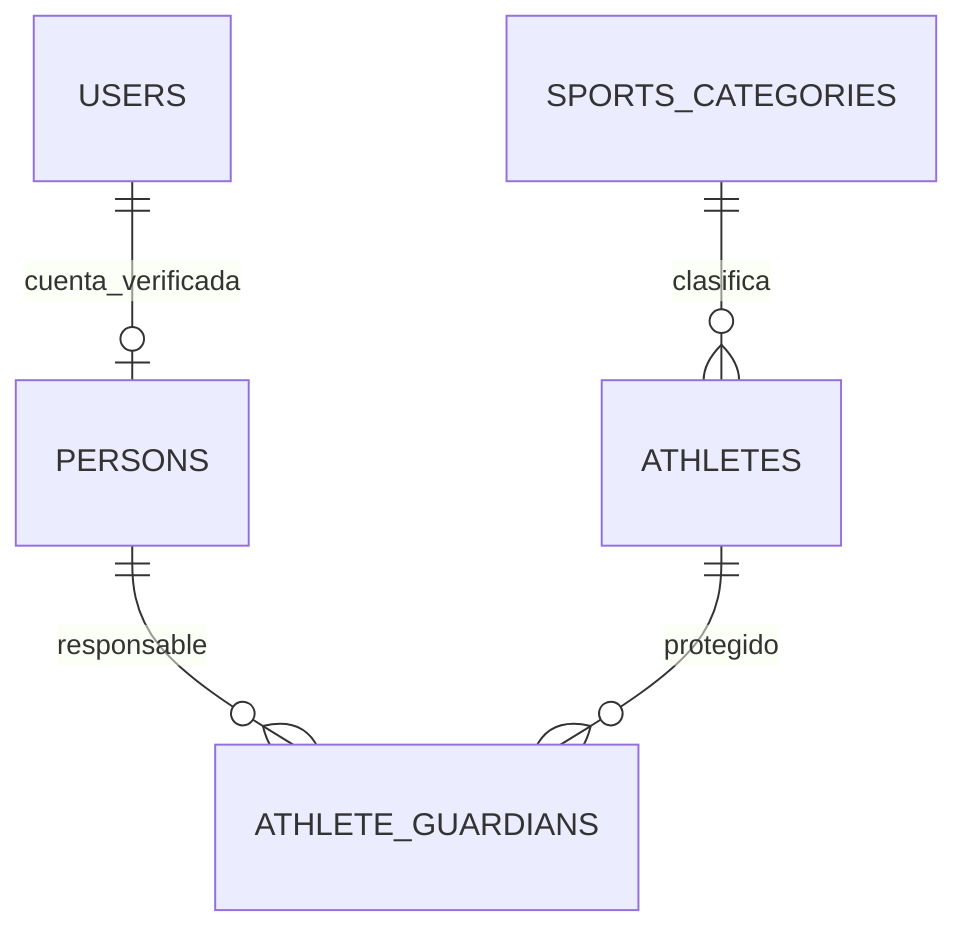

# INC-003 — Personas, familias y atletas

**Rama:** `feature/inc-003-personas-atletas-familias`  
**Base:** `feature/inc-002-sitio-publico-contacto` (PR #2 en borrador).  
**Estado:** primera implementación de código; **no ejecutada ni probada en WAMP**.

## Objetivo

Crear el expediente administrativo privado del atleta y registrar sus adultos responsables con un procedimiento de vinculación de cuentas **verificado** para que ninguna familia pueda consultar la información de otros menores.

## Componentes

- `sports_categories`: catálogo de U7, U9, U11, U13, U17, con seeder idempotente; no se establecen aún rangos automáticos de edades.
- `athletes`: nombres, apellidos, fecha de nacimiento, fecha de ingreso, categoría, estado y usuario administrativo que creó el registro.
- `athlete_guardians`: relación muchos-a-muchos entre atleta y adulto, parentesco, verificador y fecha de verificación.
- `persons`: tabla de adultos ya creada en INC-001; se reutiliza un mismo adulto para varios atletas en lugar de duplicarlo.
- Modelos `AthleteModel`, `SportsCategoryModel`, `AthleteGuardianModel` y `PersonModel`.
- `AthleteRegistrationService`: validaciones, operación transaccional y auditoría; no concede acceso a la familia por registrar un nombre.
- `FamilyLinkService`: verifica manualmente una relación entre adulto registrado y cuenta familiar activa; transacción y auditoría.
- `GET /app/atletas`, `GET /app/atletas/nuevo`, `POST /app/atletas`: gestión exclusiva de `athletes.manage`.
- `GET/POST /app/familias/verificar`: únicamente `family.links.verify` (administradores institucionales).
- `GET /app/mis-atletas`: consulta limitada por `persons.user_id = auth()->id()`, vínculo `verified_at` y atleta activo, exclusiva de rol familiar.
- Interfaces responsive de listado, inscripción, verificación de vínculos y panel familiar.
- Pruebas unitarias de `AthleteRegistrationPolicy`.

## Esquema resumido



Un adulto puede estar asociado a varios atletas; un atleta puede tener varios adultos responsables. La cuenta Shield de un adulto es opcional, y **no otorga acceso hasta que la relación haya sido verificada**.

## Reglas de seguridad

1. El listado administrativo de atletas exige `athletes.manage`. Un `coach` con `athletes.view` general no puede usar esta ruta: se diseñará su alcance por categoría más adelante.
2. El usuario `guardian` nunca especifica un ID arbitrario de atleta al consultar: el servidor obtiene las filas filtrando por su identidad autenticada y relaciones verificadas.
3. La creación de un atleta **no** asigna `persons.user_id` ni marca una relación como verificada.
4. Para asociar cuenta, un administrador con `family.links.verify` debe comprobar previamente identidad y relación de responsabilidad, fuera del formulario, e indicar el correo de la cuenta Shield activa con rol `guardian`.
5. No se permite cambiar un adulto ya vinculado a otra cuenta a través de este proceso. La operación requiere transacción y auditoría.
6. Nunca usar datos reales de menores para pruebas sin autorización. No publicar datos personales, fotos ni estadísticas individuales.
7. La categoría de ingreso se elige administrativamente. **No existe aún norma aprobada de cortes por año/edad** para asignación automática.
8. La captura de información sobre salud, identidad legal, permisos de imagen o disciplina queda fuera de esta fase.

## Instalar y probar

```powershell
cd C:\wamp64\www\acedemia-ramon-sanchez
git fetch origin
git switch --track origin/feature/inc-003-personas-atletas-familias
php spark migrate --all
php spark db:seed SportsCategoriesSeeder
php spark migrate:status
php spark routes
vendor\bin\phpunit --bootstrap vendor/autoload.php tests/unit/AthleteRegistrationPolicyTest.php
```

Si la rama ya existe localmente, usar `git switch feature/inc-003-personas-atletas-familias` y `git pull --ff-only origin feature/inc-003-personas-atletas-familias`.

**Prueba funcional con datos ficticios:** crear atleta con adulto responsable desde `/app/atletas/nuevo`; verificar que padre no lo ve inicialmente; crear la cuenta familiar mediante invitación (si no existe); confirmar vínculo en `/app/familias/verificar`; iniciar sesión familiar y ver solo su atleta en `/app/mis-atletas`.

## Pendiente antes de completar el incremento

- [ ] Ejecutar migraciones, seeder, rutas y pruebas unitarias en WAMP sin errores.
- [ ] Verificar registro transaccional y rollback ante fallos.
- [ ] Verificar que un padre no pueda consultar otros atletas ni relaciones no verificadas.
- [ ] Verificar que el utilero y los entrenadores no puedan autorizar vínculos familiares.
- [ ] Verificar que un adulto reutilizado pueda relacionarse con varios hijos sin duplicar persona.
- [ ] Validar política formal de edades/cambios de categoría con director deportivo.
- [ ] Incorporar edición/historial de cambios, más de un responsable, consentimientos versionados, dorsales y estados de atleta.
- [ ] Implementar revocación y revisión periódica de vínculos familiares.
- [ ] Revisar conservación de datos, seguridad y procedimiento ante conflictos de representación legal.
- [ ] Verificar layout en móvil y registros accesibles solo con permisos explícitos.

## Alcance futuro

INC-004: sesiones y asistencia. INC-005/006: torneos y resultados. INC-008/009: mensualidades y uniformes. Ninguno de esos módulos se mezcla con las autorizaciones familiares iniciales.
