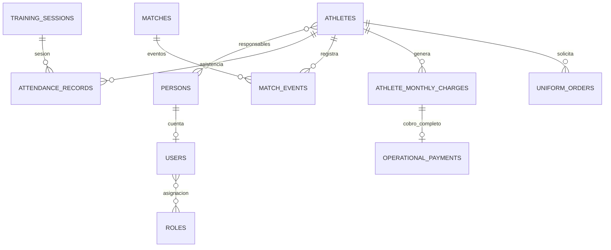

# Modelo conceptual de datos

Documento **conceptual**, no equivalente aún a migraciones aprobadas.

## Identidad y estructura

- `persons`: identidad administrativa de adultos y personal.
- `users`: cuentas individuales e invitaciones.
- `roles`, `permissions`, `user_roles`, `role_permissions`: acceso por capacidades.
- `role_assignments`: asignaciones con vigencia y alcance cuando corresponda.
- `audit_logs`: acciones relevantes sin exponer secretos.

## Atletas y responsables

- `athletes`: expediente histórico único, estado, ingreso, categoría vigente.
- `guardians` / `athlete_guardians`: relación múltiple y responsabilidad legal.
- `sports_categories` y `athlete_category_history`.
- `jersey_assignments`: dorsal vigente e historial por categoría.
- `consents`: autorizaciones versionadas de publicaciones.
- `training_sessions`, `session_categories`, `attendance_records`.

## Competición

- `tournaments`, `seasons`, `teams`, `fixtures`, `matches`, `match_categories`.
- `callups`, `callup_athletes`, `attendance_confirmations`.
- `match_events`: goles, asistencias y eventos verificables.
- `athlete_match_stats`: minutos y métricas detalladas, cuando aplique.
- `badge_definitions`, `athlete_badges`: insignias con criterios e historial.

## Cobranza operativa

- `billing_policies`: matrícula, vencimiento individual, gracia y tarifa con vigencia.
- `athlete_monthly_charges`: períodos y obligaciones.
- `operational_payments`, `payment_receipts`: pagos **completos** y comprobantes.
- `uniform_orders`, `uniform_order_items`, `uniform_order_status_history`.

## Fondo independiente de Junta

- `board_cash_funds`, `board_cash_movements`, `board_cash_reconciliations`.
- `board_expense_requests`, `board_advances`, `board_advance_settlements`.
- `board_monthly_reports`, `board_report_approvals`.

**Restricción de diseño:** no crear vínculos o automatismos que mezclen ingresos de fundador con el fondo de Junta. La reposición desde caja no debe contarse como ingreso nuevo.

## Comunicación y web

- `announcements`, `support_cases`, `case_followups`.
- `media_assets`, `publication_drafts`, `publications`.
- `enrollment_inquiries` con retención mínima de datos.

## Relaciones conceptuales

La cardinalidad exacta y las restricciones se revisarán en las migraciones de cada incremento.
