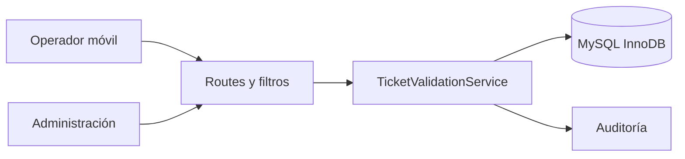

# Arquitectura
Monolito modular, sin microservicios. Reusar Shield, AuditLogger, modelos de personas cuando proceda, layouts y navegación contextual. Controladores delgados, servicios transaccionales, modelos, migraciones y pruebas.

Rutas privadas propuestas /app/eventos y /app/eventos/{id}/validar; entrada especializada /tickets. Reutilizar autenticación Shield sin crear un segundo almacén de usuarios.
Flag academy.modules.tickets.enabled=false por defecto. PrelaunchGate debe permitir solo rutas y métodos explícitos de tickets y autenticación indispensable; nunca /app completo. Mantener permisos por evento, CSRF y limitación de login. Revisar redirecciones de Shield y activación de cuentas; no abrir registro. Sin caché para rutas privadas ni de validación.
Estructura: Controllers/App/Tickets, Services/Tickets, Models/Tickets, Views/app/tickets, Database/Migrations, tests/Tickets. Config Tickets. No cambios de aplicación en TKT-000.
