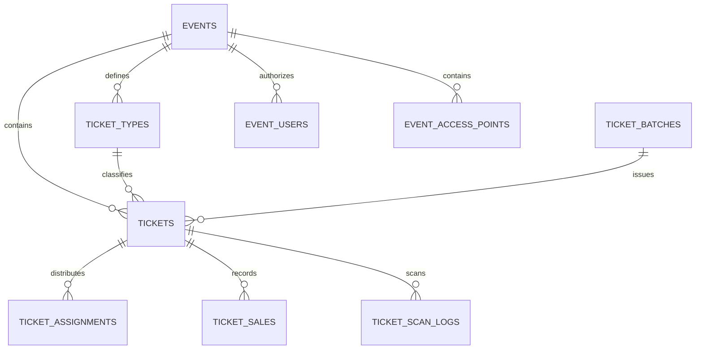

# Modelo relacional propuesto

| Tabla | Campos mínimos |
|---|---|
| events | id, slug UNIQUE, name, starts_at, access_from/to, capacity, status |
| ticket_types | id, event_id, name, price DECIMAL(12,2), adult_qty, student_qty, quota |
| ticket_batches | id, event_id, issued_by, created_at |
| tickets | id, event_id, type_id, batch_id, serial_number, token_hash BINARY(32) UNIQUE, manual_hash UNIQUE, status, redeemed_at/by, replacement_of |
| ticket_assignments | id, ticket_id, assignee_user_id, assigned_at, returned_at |
| ticket_sales | id, ticket_id, buyer_person_id nullable, buyer_name opcional, amount, currency, sold_by, sold_at, voided_at |
| ticket_scan_logs | id, event_id, ticket_id nullable, operator_id, point_id, request_id, result, created_at |
| event_users | event_id, user_id, capability, revoked_at |
| event_access_points | id, event_id, name, active |
| ticket_status_history | id, ticket_id, from_status, to_status, actor_id, reason, created_at |

UNIQUE(event_id,serial_number), UNIQUE(event_id,operator_id,request_id) para idempotencia. FK coherentes con evento; tipo y lote deben pertenecer al mismo evento (FK compuestas o validación transaccional). Índices por evento/estado y fecha. Una venta activa y asignación activa como máximo por ticket: diseñar restricciones compatibles con versión MySQL (columna generada nullable UNIQUE o tabla de estado actual). Definir tipos de FK tras revisar esquema real Shield/persons. Capacidad física contabiliza personas, cuotas contabilizan tickets; bloquear contador del evento/tipo al emitir. Reemplazos no incrementan capacidad neta.
Guardar hash del token, no secreto plano. PDF original privado o cifrado autenticado del secreto con clave externa si se requiere reimpresión; decisión pendiente. No persistir QR en public/.
