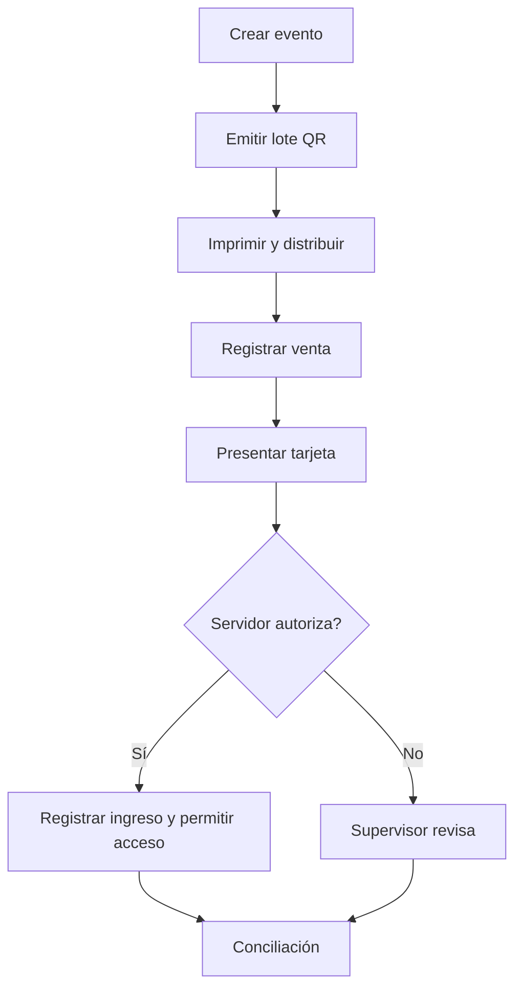

# Procesos

Antes: Junta aprueba reglas; administrador emite; vendedor registra comprador y venta según política; tesorería concilia; supervisor prueba lectores y red.
Durante: operador comprueba personas presentes, escanea, espera resultado confirmado y permite ingreso una vez. Rojo no equivale a fraude; dirigir a supervisor. No repetir ingreso por reintento de red.
Después: cerrar ventana, conciliar emitidas/vendidas/consumidas/anuladas, ingresos y devoluciones; archivar informe.
Contingencia: datos móviles y energía de respaldo. Si falla servidor, suspender validación digital; un único punto manual con lista actualizada y supervisor, registrar hora y correlativo, luego reconciliar antes de reabrir múltiples accesos. Riesgo residual de duplicación si lista desactualizada; no operar offline en paralelo.
