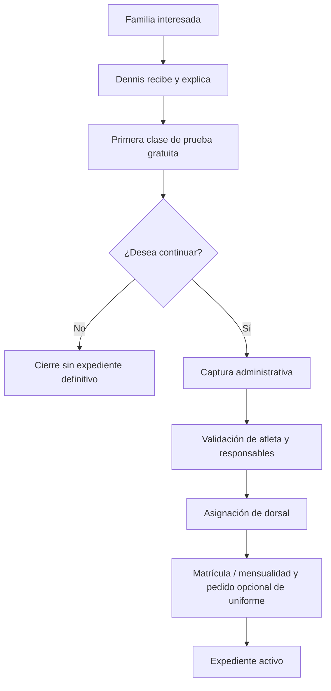
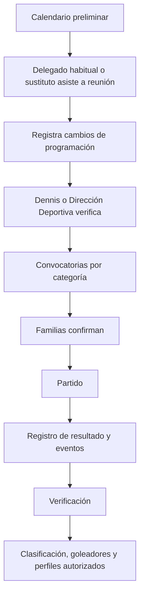
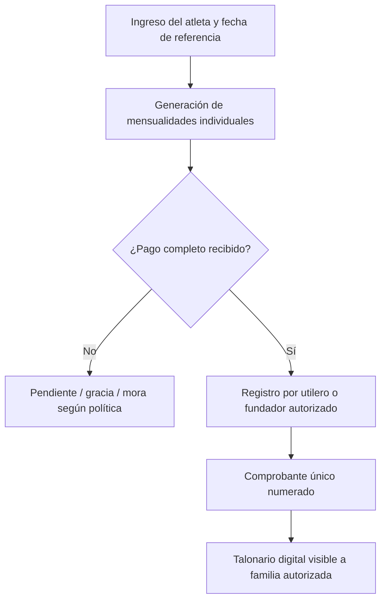

# Visión, alcance y procesos

## Propósito

Construir un ecosistema digital único de la **Academia de Fútbol Ramón Sánchez**, combinando una web institucional pública con un portal privado, con una estética moderna, elegante y móvil.

## Actores

- **Fundadores y Dennis Sánchez**: máxima administración institucional (confirmado como decisión de alcance).
- **Dirección Deportiva**: coordinación técnico-deportiva.
- **Entrenadores**: entrenamiento, asistencia, convocatorias y estadísticas según categoría y permiso.
- **Utilero**: apoyo a inscripción, pedidos de uniformes y cobros ordinarios autorizados.
- **Junta Directiva**: comité de apoyo, organización de actividades y fondo común diferenciado.
- **Padres / responsables legales**: datos de hijos, confirmación de convocatoria, comprobantes y comunicados.
- **Colaborador audiovisual**: preparación de material sin publicación automática.
- **Administrador técnico**: soporte e infraestructura, con acceso controlado.

## Mapa de procesos

| Proceso | Situación actual conocida | Propuesta |
|---|---|---|
| Captación | Recomendaciones y visitas | Web y solicitudes de primera clase gratuita; Dennis recibe y orienta |
| Inscripción | Personal autorizado registra a niño | Expediente único y validación doble |
| Entrenamientos | Miércoles y jueves 16:30–18:00; viernes eventual | Sesiones, asistencia y alertas de seguimiento |
| Competición | Programación general con confirmación semanal | Jornadas, partidos por categorías, cambios y convocatorias |
| Estadísticas | Dennis concentra la información | Goles, asistencias, minutos, resultados, tablas e insignias |
| Cobros ordinarios | Talonario físico con taco y parte para familia | Mensualidades individuales, morosidad y comprobantes digitales |
| Uniformes | Pago, fabricación y entrega aproximada en 15 días | Pedidos de local y entrenamiento a $15 cada uno |
| Fondo de Junta | Caja metálica y libro físico | Caja digital, arqueo, avances, reintegros e informe privado mensual |
| Comunicación | Dennis informa por WhatsApp, grupos separados por categoría | Comunicados oficiales en portal, difusión por grupos/comunidad propuesta |
| Publicaciones | Dennis revisa y decide publicación en Facebook | Biblioteca multimedia, revisión y consentimiento |

## Flujos fundamentales

### Captación a inscripción

### Jornada deportiva

### Cobro y comprobante

## Alcance público

Historia institucional, presentación del cuerpo técnico, categorías U7/U9/U11/U13/U17, horarios y contacto, solicitud de clase gratuita, noticias y galería autorizada, torneos, resultados, clasificación, goleadores, perfiles deportivos e insignias con consentimiento.

## Alcance privado

Gestión de usuarios y permisos, expedientes y responsables, entrenamientos/asistencia, jornadas/convocatorias, estadísticas, matrícula/mensualidades/talonarios, uniformes, fondo de Junta, transparencia familiar, comunicaciones y contenido editorial.

## Beneficios

- Continuidad operativa y menor dependencia de registros dispersos.
- Información confiable y reutilizable, sin duplicidad de captura.
- Transparencia del fondo de Junta **sin mezclarlo con los ingresos de fundadores**.
- Mejor comunicación y participación de familias.
- Identidad pública profesional y promoción orgánica.
- Historial formativo y deportivo del atleta.
